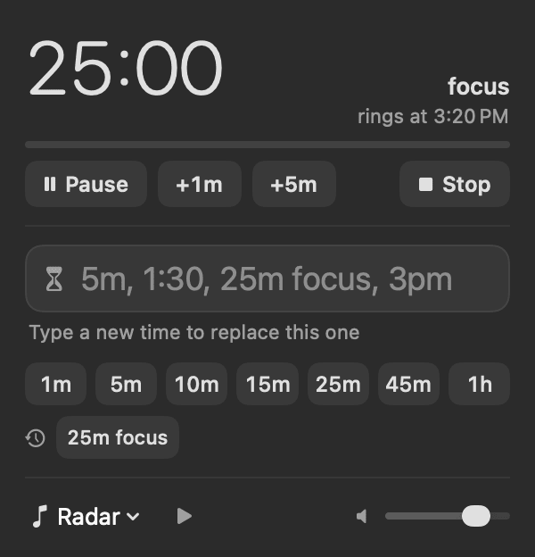
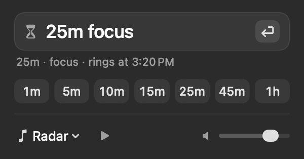
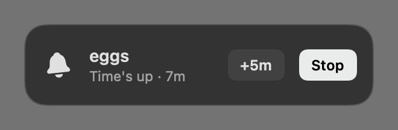

# Tick

A minimal menu bar countdown timer. Click the menu bar item, type a time, press Return. The time counts down right in the menu bar.

<p> </p>



- Type `5`, `25m focus`, `1h30`, `1:30`, `90s`, `3pm` or `at 15:30`. Words after the time become the timer's label.
- Preset chips (1 min – 1 h) and your recent custom timers.
- **⌃⌥T** opens Tick from anywhere (or stops a ringing alarm). ⌥-click the menu bar item repeats the last timer. Right-click for the menu.
- Alarm: the iPhone alarm tones that ship with macOS (Radar by default), the macOS alert sounds, or any MP3 / WAV / AIFF / M4A you add or drop on the item. Long sounds loop, short ones repeat, and the alarm stops itself after 3 minutes.
- A running timer survives quitting and relaunching.
- Starts at login (turn it off from the right-click menu).

## Requirements

macOS 26 or later. No other software needed.

## Install

**Download:** get [Tick.zip](https://github.com/byaydenrx/Tick/releases/latest/download/Tick.zip) from the [latest release](https://github.com/byaydenrx/Tick/releases/latest) (Apple silicon and Intel, macOS 26 or later).

1. Double-click `Tick.zip` to unzip it, and drag **Tick** into your Applications folder.
2. Open it. Because the app isn't notarized by Apple, macOS says it can't verify it: click **Done**.
3. Open System Settings › Privacy & Security, scroll down to “Tick was blocked”, click **Open Anyway** and confirm. You only do this once.
4. Tick's hourglass appears in the menu bar. It turns on Open at Login the first time it runs.

**Or build it yourself** (no Gatekeeper prompt), with Swift 6 from the Xcode Command Line Tools (`xcode-select --install`) or Xcode:

```sh
git clone https://github.com/byaydenrx/Tick.git
cd Tick
./install.sh
```

`install.sh` builds Tick, copies it to `~/Applications` and opens it. `./build.sh` only builds `build/Tick.app`.

## Data

- Sounds you add: `~/Library/Application Support/Tick/Sounds`
- Settings and the running timer: Tick's preferences (`defaults read com.byaydenrx.tick`)
- Log: `~/Library/Logs/Tick.log` (trimmed to the newest 256 KB once it passes 1 MB)

## Test modes

`Tick --parse "5" "25m focus" "3pm"` (how entries are read), `--snapshot <dir>` (popover and alarm card PNGs), `--add-sound <file>`, `--start "<time>"`, `--log-status`. Set `TICK_SUITE=<name>` and `TICK_ROOT=<dir>` to keep tests out of your real settings and sounds. `--play <file>` plays at full volume.

## License

MIT — see [LICENSE](LICENSE).
